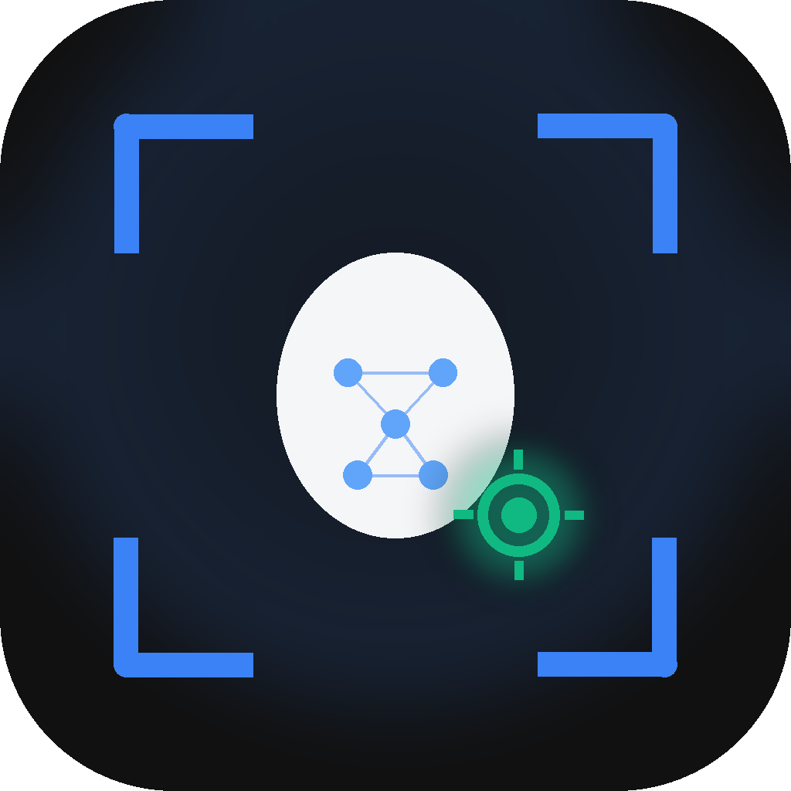

<div align="center">

  <p>
    <a href="https://github.com/amshivang"><strong>Shivang Shukla (@amshivang)</strong></a> • 
    <a href="https://github.com/amshivang?tab=repositories">Portfolio Repositories</a> • 
    <a href="mailto:linkwithshivang@gmail.com">Contact</a>
  </p>

  

  # 🛡️ Face Seeker
  ### Target Face Detector for Law Enforcement & Forensic Surveillance Analysis (v2.0.0)

  <p>
    <em>A 100% offline, air-gapped computer vision desktop suite combining a native C# .NET 8 WPF interface with an ultra-high-speed Python/Cython deep learning vision engine via local TCP socket IPC.</em>
  </p>

  <p>
    <a href="https://dotnet.microsoft.com/"></a>
    <a href="https://python.org"></a>
    <a href="https://opencv.org"></a>
    <a href="#"></a>
    <a href="https://github.com/amshivang/FaceSeeker/releases/latest"></a>
    <a href="LICENSE"></a>
  </p>

  <p>
    <a href="#-overview">Overview</a> •
    <a href="#-whats-new-in-version-200">What's New in v2.0</a> •
    <a href="#-architecture--tech-stack">Tech Stack</a> •
    <a href="#-repository-structure">Structure</a> •
    <a href="#-quick-start">Quick Start</a> •
    <a href="#-running-automated-tests">Testing</a> •
    <a href="#-privacy--security">Security</a> •
    <a href="#-author--connect">Author</a>
  </p>

</div>

---

## 📌 Overview

**Face Seeker** is an air-gapped, mission-critical desktop surveillance forensics application engineered for law enforcement agencies, digital forensics units, and intelligence analysts. In criminal investigations, analysts frequently face the bottleneck of manually examining dozens of hours of surveillance footage to identify suspects.

Face Seeker automates this workflow with high-precision deep learning inference (**35–50+ FPS**). Its decoupled architecture unites a native **C# .NET 8 WPF** desktop client with a specialized **Python vision engine**, communicating over a local loopback TCP socket. The system supports multi-target enrolment, dual-resolution inference, 1:N winner-takes-all classification, and instantaneous evidentiary reporting (CSV, JSON, and summary TXT).

---

## 🚀 What's New in Version 2.0.0

- **Decoupled C# + Python Architecture**: Native .NET 8 WPF application connected to a high-speed Python computer vision daemon via local TCP socket IPC.
- **Studio-Grade Dark Interface**: Precision dark theme inspired by Linear and Raycast, providing high visual density, smooth 60 FPS match buffering, and zero UI stutter during high-throughput scanning.
- **Dual-Resolution Inference (4x–8x Speedup)**: Video frames are downscaled to 640px for YuNet face detection while bounding boxes and landmarks are re-projected back to full 1080p/4K resolution for SFace embedding extraction.
- **1:N Winner-Takes-All Identification**: Multi-target matching computes cosine similarities across all enrolled subjects, attributing detections strictly to the highest-scoring candidate above threshold.
- **Asynchronous UI Match Queue**: Match events are buffered into a thread-safe background queue drained at 60 FPS, ensuring fluid scroll performance even during high-frequency detection bursts.
- **Instant Non-Blocking Cancellation**: Engine cancellation commands take effect immediately without locking media handles or hanging the GUI.
- **Evidentiary Export Suite**: One-click export to culture-invariant CSV, structured forensic JSON, and grouped TXT reports.
- **Target In-Memory Pre-scaling**: Suspect reference photos are scaled to 1000px JPEG in memory, reducing IPC payload overhead by 98%.
- **Comprehensive Automated Test Coverage**: Built-in test suites comprising **24 C# unit tests** (`MSTest`) and **11 Python engine tests** (`unittest`).

---

## 🛠️ Architecture & Technology Stack

```
┌─────────────────────────────────────────────────────────────┐
│                   Face Seeker Desktop (v2.0.0)              │
├──────────────────────────────┬──────────────────────────────┤
│      C# .NET 8 WPF GUI       │     Python Vision Engine     │
│  (Modern MVVM Architecture)  │      (OpenCV DNN Core)       │
├──────────────────────────────┼──────────────────────────────┤
│ • MainViewModel Cockpit      │ • FaceSearchPipeline (1:N)   │
│ • High-Frequency Batch Queue │ • YuNet Face Detector        │
│ • Precision Dark Theme       │ • SFace Feature Recognizer   │
│ • Export & Settings Manager  │ • VideoScanner Frame Loop    │
└──────────────┬───────────────┴──────────────▲───────────────┘
               │    Localhost TCP Socket IPC   │
               └───────────────►───────────────┘
                     JSON Protocol (Port 54321)
```

| Layer / Component | Technology | Version | Architectural Role & Rationale |
| :--- | :--- | :--- | :--- |
| **User Interface** | C# .NET 8, WPF | Modern MVVM | Native desktop window, drag-and-drop media ingestion, match inspector |
| **MVVM Tooling** | CommunityToolkit.Mvvm | 8.x | High-performance reactive viewmodels, observables, and commands |
| **Inter-Process Comm** | System.Net.Sockets | Native | Asynchronous UTF-8 JSON streaming over localhost TCP loopback (`127.0.0.1`) |
| **Face Detection AI** | YuNet ONNX | OpenCV DNN | Ultra-lightweight anchor-based detector with 5-point facial landmark regression |
| **Face Recognition AI**| SFace ONNX | OpenCV DNN | 128-dimensional normalized embedding extractor with Cosine Similarity matching |
| **Video Decoding** | OpenCV `VideoCapture` | 4.10+ | Multi-format video reading (`.mp4`, `.avi`, `.mkv`, `.mov`, `.wmv`) |
| **Automated Testing** | MSTest & Python `unittest`| Native | 35 automated tests validating models, services, IPC protocol, and pipelines |

---

## 📂 Repository Structure

```
FaceSeeker/
├── FaceSeeker.sln                      # Visual Studio solution file
│
├── FaceSeeker.GUI/                     # C# .NET 8 WPF Desktop Client
│   ├── FaceSeeker.GUI.csproj
│   ├── App.xaml / App.xaml.cs
│   ├── Assets/                         # Dark styles, brushes and application icon
│   ├── Controls/                       # Reusable UI controls (DropZone, MatchResultRow, TargetFaceCard)
│   ├── Models/                         # Data transfer objects and application settings
│   ├── Services/                       # ExportService, PythonBridge, SocketClient
│   ├── ViewModels/                     # MainViewModel, MatchResultViewModel
│   └── Views/                          # MainWindow, SettingsWindow, NameInputDialog
│
├── FaceSeeker.Engine/                  # Python Computer Vision Engine
│   ├── requirements.txt                # OpenCV and NumPy dependencies
│   ├── setup_build.py                  # Cython build configuration
│   └── BUILD_SOURCES/                  # Engine pipeline, detector, recognizer, socket server
│
├── models/                             # Pre-trained ONNX Neural Networks
│   ├── face_detection_yunet_2023mar.onnx
│   └── face_recognition_sface_2021dec.onnx
│
├── build/                              # Distribution and packaging scripts
│   ├── build_engine.bat                # Engine compilation script
│   └── build_gui.bat                   # Standalone self-contained executable builder
│
└── tests/                              # Automated Verification Suites
    ├── test_engine.py                  # Python engine and IPC socket tests
    └── FaceSeeker.GUI.Tests/           # C# MSTest unit test suite
```

---

## ⚡ Quick Start (Building From Source)

### Prerequisites
- Windows 10 / 11 (x64)
- [.NET 8.0 SDK](https://dotnet.microsoft.com/download/dotnet/8.0)
- [Python 3.12+](https://www.python.org/downloads/)

```bash
# 1. Clone the Repository
git clone https://github.com/amshivang/FaceSeeker.git
cd FaceSeeker

# 2. Install Python Engine Dependencies
pip install -r FaceSeeker.Engine/requirements.txt

# 3. Build & Run the Application
dotnet build FaceSeeker.sln
dotnet run --project FaceSeeker.GUI
```

### Standalone Executable Build
To generate a self-contained, single-file Windows executable bundled with the vision engine:
```cmd
build\build_gui.bat
```
The output will be placed in `dist/FaceSeeker.exe`.

---

## 🧪 Running Automated Tests

### C# GUI Unit Tests
```bash
dotnet test FaceSeeker.sln
```
Executes 24 unit tests covering `ExportService` (CSV formatting, culture invariance), `AppSettings` persistence, `MatchResultViewModel` mapping, and `SocketMessages` JSON serialization.

### Python Engine Tests
```bash
python tests/test_engine.py
```
Executes 11 automated tests covering YuNet detection, SFace embeddings, 1:N multi-target winner logic, video scanner loops, and socket IPC communication.

---

## 🔒 Privacy & Security

- **100% Air-Gapped**: Runs completely offline. Zero telemetry, zero external cloud calls, and zero remote endpoints.
- **Loopback-Bound IPC**: Socket communication is strictly bound to `127.0.0.1`.
- **Evidence Integrity**: Source surveillance footage is opened in read-only mode, guaranteeing original media remains untampered.

---

## 📜 License

Distributed under the **MIT License**. See [`LICENSE`](LICENSE) for details.

---

## 👤 Author & Connect

<div align="center">
  <p><strong>Shivang Shukla</strong></p>
  <p><em>Cybersecurity & Digital Forensics Scholar @ UPSIFS (Uttar Pradesh State Institute of Forensic Sciences)</em></p>

  <p>
    <a href="https://github.com/amshivang"></a>
    <a href="https://www.linkedin.com/in/amshivang/"></a>
    <a href="mailto:linkwithshivang@gmail.com"></a>
  </p>

  <a href="https://buymeacoffee.com/amshivang">
    
  </a>
  <br>
  <strong><a href="https://buymeacoffee.com/amshivang">☕ Support my open-source work on Buy Me A Coffee!</a></strong>
</div>
